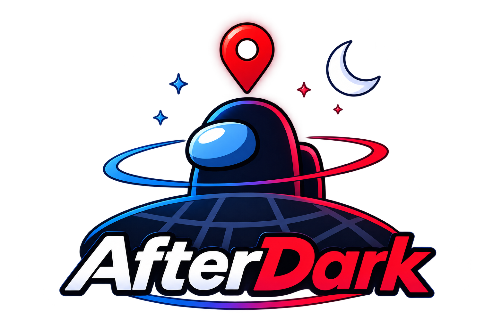
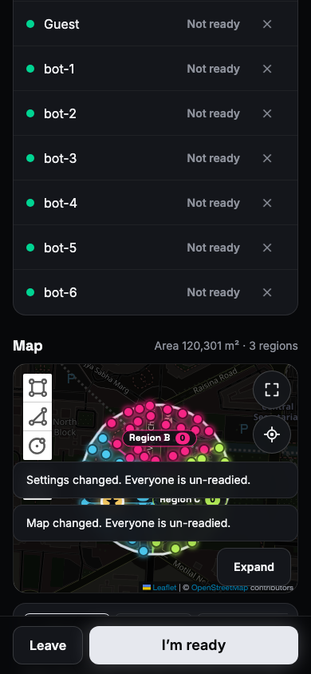
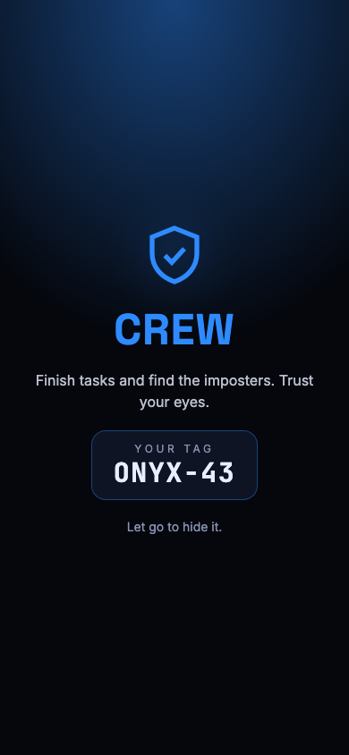
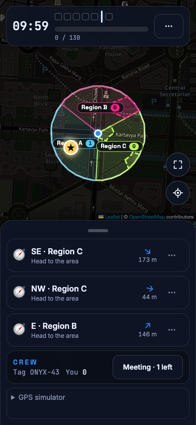
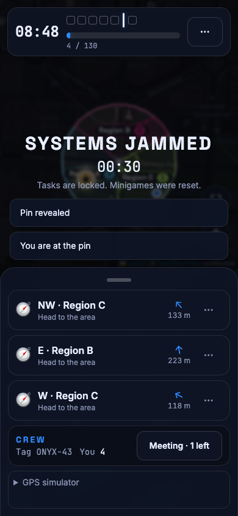
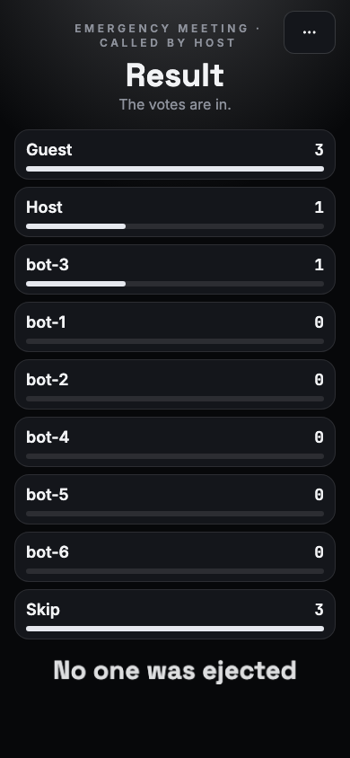
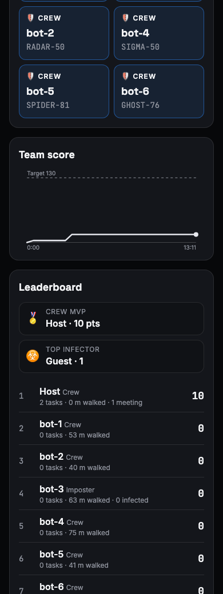
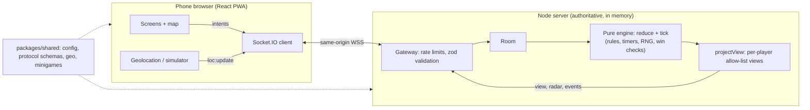

<p align="center"></p>

# AfterDark 🌙

**Among Us played with your feet.** AfterDark is a real-world, GPS-based social-deduction game that runs in your phone's browser as an installable PWA.

- **Crew** follow directions like "North-East · Region A" to hidden task spots and solve quick minigames to reach the team target.
- **Imposters** secretly infect players by staying close to them, jam everyone's tasks, plant fake tasks, and disguise their screens to bluff in co-op tasks.
- **Anyone** can call an emergency meeting: everyone gathers at the Base, argues face to face, and votes someone out.

No accounts and no app store: share a 6-letter code and play. **Live:** <https://afterdark-24gx.onrender.com>

> Built for the CodeNMode hackathon at SIT, written entirely with Claude Code, one phase per session ([build plan](docs/BUILD_PLAN.md), [progress](PROGRESS.md)).

[](https://github.com/arunishrajput/afterdark/actions/workflows/ci.yml)

<table>
  <tr>
    <td></td>
    <td></td>
    <td></td>
    <td></td>
    <td></td>
    <td></td>
  </tr>
  <tr>
    <td>Lobby and area</td><td>Secret role</td><td>Crew tasks</td><td>Task Stop</td><td>Meeting vote</td><td>Results</td>
  </tr>
</table>

## How to play
1. **Gather** 4 to 12 people somewhere open and safe. The host creates a game, draws the play area on the map (and any no-go zones), and shares the code. Everyone joins, allows location and taps **Ready**.
2. **Spawn and reveal.** Each player walks to their own start pin, then presses and holds to read their secret role: **crew** (blue) or **imposter** (red, with a secret ability class).
3. **Crew** get three task cards that only say where to look ("NE · Region B"). Walk into that slice of the map and the exact pin appears; at the pin, stop somewhere safe and solve a 20-second minigame (7 kinds, plus a co-op task where two players swap PINs).
4. **Imposters** infect a crew member by staying within 8 m of them for 10 s; the victim is never told. They can also jam every task for 30 s (Saboteur), plant fake tasks (Phantom), or make their screen look like a crew phone (Camouflage).
5. **Meetings.** Anyone can call one: every phone alarms, everyone walks to the Base, discusses face to face and votes. The ejected player's role is revealed.
6. **Winning.** Crew win by reaching the team target score or ejecting every imposter. Imposters win when enough crew are compromised (the line on the infection boxes) or by having more progress when time runs out.

Full rules: [RULES.md](docs/RULES.md). Safety first: AfterDark never asks you to run, shows "Stop somewhere safe" before every puzzle, and lets players report unsafe spots.

**Try it alone:** on the live URL, create a game, open Settings → **Test mode**, tap **Add 7 bots**, and use the GPS simulator (long-press the map to move). A 3-minute judge demo is scripted in [DEMO.md](docs/DEMO.md).

## Run it locally
Requires Node 24+ (see `.nvmrc`) and pnpm 11 (`corepack enable` picks up the pinned version).
```bash
pnpm install
pnpm dev        # game server :3000 + client :5173 → open http://127.0.0.1:5173
```
Phone browsers only allow GPS on HTTPS pages: run `pnpm tunnel` in a second terminal and open the `https://….trycloudflare.com` URL it prints on your phone ([MANUAL_SETUP.md](docs/MANUAL_SETUP.md#phase-2-onward-testing-on-your-real-phone-optional-but-recommended)).

## Test
| Command | What it does |
|---|---|
| `pnpm verify` | Lint (type-aware ESLint + Prettier), typecheck, every unit and integration test (Vitest, 1100+), and the production build. Green on every commit. |
| `pnpm e2e` | Playwright: lobby, setup, every minigame, infection, abilities, co-op, meetings, results, the PWA, and one full 8-player game with a raw-network leak scan. First run: `pnpm exec playwright install chromium`. If another app holds port 3000: `E2E_SERVER_PORT=3100 pnpm e2e`. |
| `pnpm bots -- --code ABC123 --count 7` | Bot players that join a lobby over real sockets ([TESTING.md §5](docs/TESTING.md#5-bots-toolsbots)). |
| `pnpm bots:simulate --games 200 --players 8` | Headless balance runs with the real engine. |
| `pnpm bots:load --lobbies 20 --players 8` | Load test: 20 lobbies of 8 bots, with latency, server tick times and memory ([PROGRESS.md](PROGRESS.md)). |

The most important tests are the **leak tests**: every player's view is built from an allow-list, and tests prove that a crew phone never receives another player's role, who is infected, or which tasks are fake, down to the raw Socket.IO frames ([TESTING.md §3](docs/TESTING.md#3-leak-tests-mandatory-from-phase-1)).

## Deploy
AfterDark is one Node process: it serves the built client and the Socket.IO server on the same port, so there is no CORS and HTTPS/WSS comes from the host. It deploys to [Render](https://render.com) from [`render.yaml`](render.yaml) (free plan, region `singapore`, auto-deploy on every push to `main`).

| | |
|---|---|
| Build / start | `corepack enable && pnpm install --frozen-lockfile && pnpm build`, then `pnpm start` (`node apps/server/dist/index.js`) |
| Health / build id | `GET /health` → `{"ok":true}`; `GET /version` → `{"sha":"<git commit>"}`. The lobby and home screen show `build <short sha>`. |
| Env | `NODE_ENV=production`, `LOG_LEVEL=info`, `ALLOW_TEST_MODE=true` (bots and the GPS simulator for demos), `PORT` (set by Render) |
| Try it locally | `pnpm build && NODE_ENV=production ALLOW_TEST_MODE=true PORT=3100 pnpm start` |
| Smoke test | `BASE_URL=https://<service>.onrender.com pnpm exec playwright test e2e/prod-smoke.spec.ts` |

**Cold start:** the free tier sleeps after about 15 minutes idle, and the first load then takes up to a minute. A deploy restarts the process, so running lobbies end (game state is in memory by design); players see "The server is restarting" first.

## Architecture

The server decides everything: every rule, timer, random roll and win check lives in a pure engine with an injected clock and RNG. The client only draws and sends intents. Details: [ARCHITECTURE.md](docs/ARCHITECTURE.md) · [PROTOCOL.md](docs/PROTOCOL.md) · [DECISIONS.md](docs/DECISIONS.md) (every design decision, with its reason).

**Layout:** `apps/client` (Vite + React + Tailwind + Zustand + react-leaflet), `apps/server` (Express + Socket.IO + pino), `packages/shared` (types, zod schemas, config, turf geometry, seeded RNG, minigames), `tools/bots` (bot CLI, load test), `e2e/` (Playwright).

## Docs
| | |
|---|---|
| Product | [PRD](docs/PRD.md) · [Original concept](docs/CONCEPT.md) · [INFILTR8 notes](docs/reference/INFILTR8_NOTES.md) · [Demo script](docs/DEMO.md) |
| Game design | [Rules](docs/RULES.md) · [Roles & visibility](docs/ROLES.md) · [Scoring](docs/SCORING.md) · [Config](docs/CONFIG.md) · [Map & regions](docs/MAP_AND_REGIONS.md) · [Tasks](docs/TASKS.md) · [Meetings](docs/MEETINGS.md) |
| Engineering | [Architecture](docs/ARCHITECTURE.md) · [Protocol](docs/PROTOCOL.md) · [UI/UX](docs/UI_UX.md) · [Testing](docs/TESTING.md) · [Decisions](docs/DECISIONS.md) · [Changelog](CHANGELOG.md) |
| Process | [CLAUDE.md](CLAUDE.md) · [Build plan](docs/BUILD_PLAN.md) · [Manual setup](docs/MANUAL_SETUP.md) · [Progress](PROGRESS.md) |

## Credits
- Map data © [OpenStreetMap](https://www.openstreetmap.org/copyright) contributors, tiles from the OpenStreetMap tile servers (darkened in CSS). Heavy public use should move to a keyed tile provider ([ADR-039](docs/DECISIONS.md)).
- Fonts: Inter, Space Grotesk and JetBrains Mono (SIL Open Font License), self-hosted through Fontsource.
- Built on React, Leaflet, Leaflet-Geoman, Turf, Socket.IO, Express, zod, pino, Vite, Vitest and Playwright.
- Game design draws on the original AfterDark concept and the INFILTR8 design document ([notes](docs/reference/INFILTR8_NOTES.md)).

## Licence
[MIT](LICENSE) © 2026 Arunish Rajput
